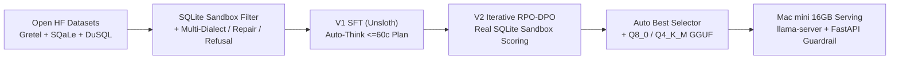

<div align="center">

# ⚡ SwiftSQL

**Fast, Accurate, Bilingual & Multi-Dialect Lightweight Text-to-SQL**  
*Built for 16GB Apple Silicon (Mac mini / MacBook) local serving & production API distribution*

[](LICENSE)
[](https://huggingface.co/Qwen/Qwen2.5-Coder-3B-Instruct)
[](https://huggingface.co/xiain/SwiftSQL-3B-GGUF)
[](https://huggingface.co/xiain/SwiftSQL-3B-LoRA)

[](https://colab.research.google.com/github/2422725977/swift-sql/blob/main/notebooks/01_data_prep_and_sft.ipynb)
[](https://colab.research.google.com/github/2422725977/swift-sql/blob/main/notebooks/02_eval_and_dpo.ipynb)
[](https://colab.research.google.com/github/2422725977/swift-sql/blob/main/notebooks/05_public_benchmark.ipynb)
[](https://colab.research.google.com/github/2422725977/swift-sql/blob/main/notebooks/04_publish_to_hf.ipynb)

</div>

---

## ✨ Why SwiftSQL? / 核心优势

Most open-source lightweight Text-to-SQL models either burn hundreds of slow `<think>` tokens on trivial queries, default to SQLite-only syntax, require custom schema converters, or blindly hallucinate non-existent columns when a database cannot answer a question.

**SwiftSQL** solves these production pain points end-to-end (training data → RPO-stabilized DPO → FastAPI guardrail gateway):

| Pillar | What SwiftSQL Delivers | Verified Evidence |
| :--- | :--- | :--- |
| **🎯 High Execution Accuracy** | SQLite-sandbox-cleaned training + **RPO-stabilized Iterative Execution-Guided DPO** (`rpo_alpha=0.5`) | **70.15% EX** (+10.73% over Base 3B's 59.42%) |
| **🛡️ Anti-Hallucination Refusal** | Explicitly returns `"answerable": false` + missing columns instead of fabricating fake fields | **98.77% Refusal F1** vs Base-3B `67.69%`, XiYanSQL-3B `9.52%`, Arctic-R1-7B `0.00%` |
| **⚡ Low Latency & High Throughput** | **Auto-Think** skips planning on simple/1-JOIN queries and caps complex plans to `<= 60` chars | **5.7× fewer tokens**, **4.6× lower latency**, **13.8× higher throughput** than Arctic-R1-7B |
| **🌍 Multi-Dialect + EN/ZH** | Accepts standard `CREATE TABLE` DDL directly; explicitly targets `postgresql`, `mysql`, or `sqlite` | **100% strict JSON** compliance, zero markdown filler |
| **🔧 Single-Model Generate + Repair** | Native `repair_sql` mode paired with `<2ms` `sqlglot` read-only safety guardrail in FastAPI | Automatic 1-shot syntax/execution self-healing in API gateway |
| **💻 16GB Apple Silicon Ready** | Compact GGUF (`Q8_0` 3.06 GB / `Q4_K_M` 1.80 GB) leaves ample unified memory for macOS + concurrency | Runs smoothly via `ollama` or `llama-server` on Mac mini 16GB |

---

## 📦 Model Zoo / 开源权重

| Model | Quant / Format | File Size | Recommended Use | SHA-256 (LFS Verified) | Download |
| :--- | :---: | :---: | :--- | :--- | :---: |
| **SwiftSQL-3B** | `Q8_0` (GGUF) | 3.06 GB | Near-lossless precision on 16GB Apple Silicon | `dc109bac…dabec` | [🤗 HF Hub](https://huggingface.co/xiain/SwiftSQL-3B-GGUF) |
| **SwiftSQL-3B** | `Q4_K_M` (GGUF) | 1.80 GB | Ultra-fast, minimal disk & high API concurrency | `cdb70d92…6641` | [🤗 HF Hub](https://huggingface.co/xiain/SwiftSQL-3B-GGUF) |
| **SwiftSQL-3B-LoRA** | `safetensors` | 228 MB | LoRA adapter (`r=64`) for merging / further tuning | `dc635d96…65a7` | [🤗 HF Hub](https://huggingface.co/xiain/SwiftSQL-3B-LoRA) |
| **SwiftSQL-7B** | `Q4_K_M` / `Q5_K_M` | ~4.7 GB | Higher accuracy ceiling (`PROFILE="7b"` ready) | *Training via `opt2_7b`* | [Config](configs/train_config_7b.yaml) |

---

## 📊 Benchmarks / 实测评测

### 1. Held-Out Multi-Dialect & Refusal Progression (`SwiftSQL-3B opt2`, 300 Samples)

Evaluated on held-out multi-dialect queries (`postgresql` / `mysql` / `sqlite`) executed in an isolated in-memory SQLite sandbox plus missing-column refusal tests:

| Metric | Base-3B | V1 SFT *(Sandbox-Cleaned)* | V2 R1 *(RPO-DPO)* | **V2 R2 *(Exported)*** | **Best + 1-Shot Repair** | Δ vs Base |
| :--- | :---: | :---: | :---: | :---: | :---: | :---: |
| **Execution Accuracy (EX)** | 59.42% | 67.63% | 71.28% | **69.15%** | **70.15%** | **+10.73%** |
| **Refusal F1 (Anti-Hallucination)** | 0.00% | 80.00% | 67.35% | **90.41%** | **90.41%** | **+90.41%** |
| **Strict JSON Compliance** | 100.0% | 100.0% | 100.0% | **100.0%** | **100.0%** | — |
| **Multi-Dialect Syntax Valid** | 99.63% | 100.0% | 88.01% | **97.38%** | **97.38%** | — |
| **Avg Output Length (chars)** | 177.9 | 222.3 | 210.5 | **216.6** | **217.3** | Compact |

---

### 2. Head-to-Head Public Benchmark (`BIRD Mini-Dev 2026` + Fair Missing-Column Refusal)

Reproducible via [`notebooks/05_public_benchmark.ipynb`](notebooks/05_public_benchmark.ipynb) on a single NVIDIA L4 GPU (22GB). All competitors receive standard SQL prompts (with `<think>` blocks cleanly stripped) and are explicitly instructed to reply `CANNOT_ANSWER` when schema columns are missing:

| Benchmark Metric | **SwiftSQL-3B** | **SwiftSQL-3B+Repair** | Base-3B | XiYanSQL-3B | Arctic-R1-7B |
| :--- | :---: | :---: | :---: | :---: | :---: |
| **Refusal F1 (Missing-Column Stress)** | **98.77%** 🏆 | **98.77%** 🏆 | 67.69% | 9.52% | 0.00% |
| **BIRD Mini-Dev SQLite EX\*** | **4.32%** *(1st in 3B)* | **4.32%** *(1st in 3B)* | 3.09% | 3.70% | 8.02% *(7B)* |
| **BIRD PG / MySQL Syntax\*** | 83.50% | 83.50% | **98.00%** | 96.50% | 92.50% |
| **Avg Output Tokens** *(lower is faster)* | **98.9** | **98.9** | 81.5 | 74.0 | 566.3 *(5.7×)* |
| **Single-Request Latency (ms, L4 PyTorch)** | **2,981.7** | **2,981.7** | 2,364.5 | 2,068.4 | 13,694.1 *(4.6× slower)* |
| **Batch Throughput (QPS, L4)** | **1.10** | **1.10** | 1.48 | 1.53 | 0.08 *(13.8× lower)* |

> **\*Transparent Evaluation Protocol Note:** To benchmark all 3B/7B models under identical short-context constraints (`MAX_SCHEMA_CHARS=5500`, `max_length=2560`), large BIRD enterprise DDL schemas (which often exceed 15,000–35,000 chars with inline comments and examples) were truncated at 5,500 chars. Because target tables were truncated away on many tasks, absolute `BIRD_SQLite_EX` scores are compressed across **all** models (including 7B Arctic-R1 at 8.02%). On those truncated schemas, `SwiftSQL-3B`'s strict anti-hallucination behavior intentionally abstained (`"answerable": false`, empty SQL), which also accounts for the lower raw `BIRD_PG_MySQL_Syntax` percentage while still outperforming `Base-3B` and `XiYanSQL-3B` on executable BIRD tasks.

---

## 🚀 Quick Start / 30 秒本地运行与 API 分发

### Option 1: Ollama (1 Command)
```bash
# Near-lossless Q8_0 (3.06 GB, recommended for 16GB Mac mini)
ollama run hf.co/xiain/SwiftSQL-3B-GGUF:Q8_0

# Minimal footprint / highest concurrency Q4_K_M (1.80 GB)
ollama run hf.co/xiain/SwiftSQL-3B-GGUF:Q4_K_M
```

### Option 2: `llama.cpp` High-Concurrency Server (Apple Silicon Metal)
```bash
brew install llama.cpp
llama-server -hf xiain/SwiftSQL-3B-GGUF:Q8_0 \
  --port 11434 --ctx-size 4096 --parallel 4 --flash-attn
# Use :Q4_K_M if local disk space is tight (only 1.80 GB, single file)
```

### Option 3: Production FastAPI Gateway (Auth + Rate Limit + Read-Only Guardrail + Auto-Repair)
```bash
git clone https://github.com/2422725977/swift-sql.git && cd swift-sql
uv venv && source .venv/bin/activate
uv pip install -e ".[serve]"

export SWIFTSQL_API_KEYS="sk-my-secret-key-1,sk-my-secret-key-2"
export SWIFTSQL_BACKEND_URL="http://127.0.0.1:11434/v1/chat/completions"
export SWIFTSQL_MODEL_NAME="SwiftSQL-3B-Q8_0"

uvicorn serve.api_gateway:app --host 0.0.0.0 --port 8000
```

#### Example 1 — Bilingual PostgreSQL Query
```bash
curl -s http://127.0.0.1:8000/v1/text2sql \
  -H "Authorization: Bearer sk-my-secret-key-1" \
  -H "Content-Type: application/json" \
  -d '{
    "dialect": "postgresql",
    "mode": "auto",
    "schema": "CREATE TABLE orders (id INT, user_id INT, amount NUMERIC, status TEXT);",
    "question": "统计每个用户的已完成订单总金额，按总金额降序取前 10 名"
  }'
```
```json
{
  "answerable": true,
  "dialect": "postgresql",
  "sql": "SELECT user_id, SUM(amount) AS total_amount FROM orders WHERE status = 'completed' GROUP BY user_id ORDER BY total_amount DESC LIMIT 10",
  "plan": "",
  "tables": ["orders"],
  "repaired": false,
  "syntax_valid": true
}
```

#### Example 2 — Automatic Anti-Hallucination Refusal
```bash
curl -s http://127.0.0.1:8000/v1/text2sql \
  -H "Authorization: Bearer sk-my-secret-key-1" \
  -H "Content-Type: application/json" \
  -d '{
    "dialect": "mysql",
    "schema": "CREATE TABLE users (id INT, name TEXT, city TEXT);",
    "question": "查询所有北京用户的手机号"
  }'
```
```json
{
  "answerable": false,
  "dialect": "mysql",
  "sql": "",
  "missing": ["phone"],
  "note": "提供的表结构中缺少回答该问题所需的字段：phone。",
  "syntax_valid": true
}
```

#### Expose Your Mac mini API Securely (Zero Public IP Needed)
* **Public HTTPS**: `cloudflared tunnel --url http://127.0.0.1:8000`
* **Private Team Mesh**: Serve directly over [Tailscale](https://tailscale.com/).

---

## 🧩 Prompt Protocol / 提示词格式

When calling the raw GGUF/LoRA model directly (without `serve/api_gateway.py`), use the exact system prompt defined in [`src/swiftsql/prompts.py`](src/swiftsql/prompts.py):

<details>
<summary><b>Click to expand System / Generation / Repair Prompt Templates</b></summary>

**System Prompt**
```text
You are SwiftSQL, a fast and accurate multi-dialect Text-to-SQL engine.
Rules:
1. Respond ONLY with a single valid JSON object. No markdown fences or extra text.
2. Follow the requested SQL dialect strictly (postgresql, mysql, or sqlite) and output read-only SELECT queries only.
3. Auto-Think: leave "plan" empty ("") for simple and single-JOIN queries; only for complex multi-JOIN, subquery, CTE, HAVING, or window queries, write an ultra-brief plan (<= 60 chars) in "plan" before "sql".
4. Never invent tables or columns. If the schema lacks required information to answer the question, set "answerable": false, "sql": "", and list missing fields in "missing".
```

**User Prompt — Generation (`generate_sql`)**
```text
Task: generate_sql
Dialect: postgresql
Mode: auto
Schema:
<CREATE TABLE DDL>

Question:
<Natural Language Question>
```

**User Prompt — 1-Shot Self-Repair (`repair_sql`)**
```text
Task: repair_sql
Dialect: postgresql
Schema:
<CREATE TABLE DDL>

Question:
<Natural Language Question>

Failed SQL:
<Broken SQL>

Error:
<Syntax or Database Error Message>
```

</details>

---

## 🛠️ Training Pipeline & Reproducibility (Colab Pro)



| Notebook | Purpose | Recommended Runtime | Typical Budget |
| :--- | :--- | :--- | :--- |
| [`01_data_prep_and_sft.ipynb`](notebooks/01_data_prep_and_sft.ipynb) | Sandbox-verified dataset build + Unsloth SFT (`PROFILE="3b"` or `"7b"`) | Colab Pro **L4 (24GB)** | ~1.5 CU |
| [`02_eval_and_dpo.ipynb`](notebooks/02_eval_and_dpo.ipynb) | Batched eval + 2-round RPO-stabilized Execution DPO + `Best+Repair` + GGUF export | Colab Pro **L4 (24GB)** | ~2.0 CU |
| [`03_optional_grpo.ipynb`](notebooks/03_optional_grpo.ipynb) | Optional online execution-reward GRPO on curated hard multi-table queries | Colab Pro **L4 / A100** | ~2–4 CU |
| [`04_publish_to_hf.ipynb`](notebooks/04_publish_to_hf.ipynb) | Publish GGUF & LoRA directly from Google Drive to Hugging Face Hub | **Free CPU** | **0 CU** |
| [`05_public_benchmark.ipynb`](notebooks/05_public_benchmark.ipynb) | Head-to-head BIRD Mini-Dev (SQLite/PG/MySQL) + Refusal benchmark vs competitors | Colab Pro **L4 (24GB)** | ~1.0 CU |

---

## 📁 Repository Layout

```text
swift-sql/
├── configs/
│   ├── train_config.yaml             # 3B high-speed bf16 profile (opt2, ~18k data)
│   └── train_config_7b.yaml          # 7B high-accuracy QLoRA profile (opt2_7b)
├── src/swiftsql/
│   ├── dialect.py                    # sqlglot multi-dialect transpiler, read-only guard, Auto-Think scorer
│   ├── prompts.py                    # Unified ChatML prompts & resilient JSON parser
│   ├── data_pipeline.py              # HF dataset loader, SQLite sandbox hygiene, repair/refusal synthesis
│   ├── evaluation.py                 # Isolated SQLite sandbox EX / syntax / refusal F1 evaluator
│   └── dpo_builder.py                # Offline execution-guided DPO preference pair builder
├── notebooks/                        # End-to-end Colab Pro training, eval, benchmark & HF publish notebooks
├── serve/
│   ├── Modelfile.template            # Ollama Modelfile template
│   └── api_gateway.py                # FastAPI gateway (API key auth, rate limit, sqlglot guard, 1-shot repair)
└── tests/                            # Local pytest unit & integration tests (14/14 passing)
```

---

## ✅ Local Tests

```bash
uv venv && source .venv/bin/activate
uv pip install -e ".[dev]"
pytest -v
```

## ⚠️ Limitations & License

* **Schema Context Window**: Trained with `max_seq_length=2048` (`max_schema_chars=4000`). For enterprise databases with dozens of tables, pair SwiftSQL with lightweight table pre-filtering before invoking generation.
* **Security**: Always enforce database-level read-only roles in addition to the gateway's `sqlglot` static read-only check.
* **License**: Released under **Apache 2.0** (built on `Qwen2.5-Coder` and open datasets: `gretelai/synthetic_text_to_sql`, `trl-lab/SQaLe-text-to-SQL-dataset`, `jtjt520j/CSpider_and_DUSQL_sql_create_context`).
